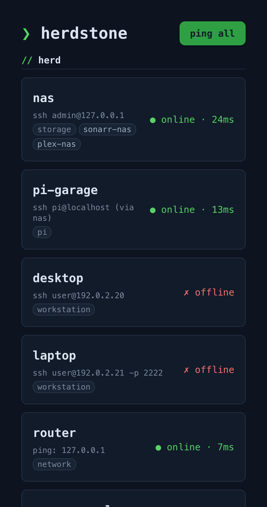
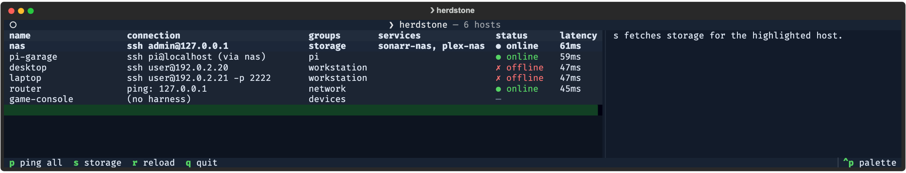

# Herdstone

Herdstone is a small monitor for a personal herd of machines: servers, Macs,
Windows boxes, Raspberry Pis, and devices you only want listed. You describe
the machines once in a JSON inventory, and Herdstone tells you which are
online, how full their disks are, and how busy they are. It can also push your
SSH public key to a machine.

It exists so one inventory file drives every view: a CLI for scripts, a
keyboard TUI for a terminal or an SSH session, and a phone-friendly web UI
for checking the herd from the couch. Nothing is installed on the monitored
machines; Herdstone uses ping, a TCP probe, and plain `ssh` commands.





Both screenshots use a sample inventory with made-up hosts.

Looking for the media remote (Sonarr/Radarr/Plex search/status/add)? It moved
to the **Sync_Plex** repo along with its design docs: `syncplex media ...`,
web UI on port 8788.

---

## What it does

- **Lists the herd** from one or more `hosts.json` inventories, with each
  host's connection, groups, and the services it offers.
- **Pings** one host, a group, or everything, concurrently. For `ssh` hosts,
  reachability is ICMP ping **with a TCP fallback to the ssh port**: Windows
  blocks inbound ICMP by default while sshd answers fine, so an open ssh port
  counts as online (the result's command field says which method decided).
- **Reads disk usage** over ssh (`df` on Unix, PowerShell on Windows),
  skipping pseudo filesystems.
- **Shows htop-style disk/cpu/mem meters** for Linux hosts from a single
  one-line probe that reads numbers the kernel already keeps; all rendering
  happens locally and nothing is installed remotely.
- **Pushes your SSH public key** to a host (see [push-key](#push-key)).
- **Runs commands locally** when the target is the machine Herdstone runs on,
  and hops through a jump host when the inventory says so.

---

## Architecture

One Python engine, three thin presentation layers. There is no internal REST
API: the CLI, TUI, and web UI all import the same `engine` package and call
the same functions in-process.

```plaintext
herdstone/
├── backend/
│   ├── pyproject.toml        # Python project config (uv)
│   ├── Dockerfile            # web UI image (no ssh client, see below)
│   ├── engine/               # The engine package
│   │   ├── models.py             # Machine, Service, CommandResult dataclasses
│   │   ├── config.py             # hosts.json search path, .env loading
│   │   ├── inventory.py          # hosts.json parser
│   │   ├── ping.py               # concurrent ICMP reachability, TCP fallback
│   │   ├── ssh.py                # run commands over SSH (or locally)
│   │   ├── storage.py            # disk usage (df / PowerShell, OS-aware)
│   │   ├── stats.py              # disk/cpu/mem meters (Linux)
│   │   ├── cli.py                # Typer entry point (doubles as IPC bridge, --json everywhere)
│   │   ├── tui/app.py            # Textual TUI (couch/SSH use)
│   │   └── web/app.py            # NiceGUI web UI (phone use, Tailscale-bound)
│   └── tests/
├── cli/herdstone             # shell wrapper: uv run into backend
├── deploy/                   # compose file for the web UI container
├── docs/screenshots/         # README images (sample data)
├── .env -> ../personal_credentials/personal.env   # symlink, gitignored
├── .env.example              # placeholder file (no keys needed today)
└── README.md

../personal_credentials/personal_hosts.json   # THE inventory: machines + services they offer
../personal_credentials/personal.env # env vars referenced by personal_hosts.json (if any)
```

The shared discovery, ssh, and host-stats plumbing lives in the
`readable-utils` package (git-pinned to a tag, see `[tool.uv.sources]` in
`backend/pyproject.toml`), shared with the status_board repo.

---

## Quick start

```bash
git clone git@github.com:ReadableCode/herdstone.git
cd herdstone

uv python install 3.14
uv python pin 3.14

cd backend
uv sync
uv run herdstone --help
```

Point it at an inventory (any of the search paths below, or
`HERDSTONE_HOSTS=/path/to/hosts.json`), then:

```bash
uv run herdstone hosts
uv run herdstone ping --all
uv run herdstone tui
uv run herdstone web
```

`cli/herdstone` is a thin wrapper that runs the same entry point with
`uv run --project backend`, so it can be put on your `PATH`.

---

## Inventory: `hosts.json`

Each host declares how to reach it (`harness`: `ssh` / `ping` / `none`) and,
optionally, **which services it offers**. Adding another instance of anything
is a config-only change, no code.

```json
{
  "hosts": [
    {
      "name": "nas",
      "hostname": "192.0.2.10",
      "user": "root",
      "os": "linux",
      "harness": "ssh",
      "groups": ["unraid"],
      "aliases": ["sshnas"],
      "services": [
        { "type": "sonarr", "name": "sonarr-nas", "port": 8989,  "api_key_env": "SONARR_NAS_API_KEY" },
        { "type": "radarr", "name": "radarr-nas", "port": 7878,  "api_key_env": "RADARR_NAS_API_KEY" },
        { "type": "plex",   "name": "plex-nas",   "port": 32400, "api_key_env": "PLEX_NAS_TOKEN" }
      ]
    }
  ]
}
```

Host defaults: `id` falls back to `name`, `hostname` to `name`, `port` to 22,
`os` to `other`, and `harness` to `ssh` when a `user` is set (`none`
otherwise). Targets on the command line match `id`, `name`, or any alias,
case-insensitively.

Optional host fields: `identity_file` (ssh `-i`) and `jump`, the name/alias
of another inventory host to hop through, injected as `ssh -J user@host:port`
so the chain lives entirely in the inventory, **deliberately not in any
machine's `~/.ssh/config`**. The hop is skipped automatically when herdstone
runs on the jump machine itself, and commands targeting *this* machine run
locally with no ssh at all.

Optional service fields: `scheme` (default `http`), `base_url` (full override),
`quality_profile` and `root_folder` (preferred add-time defaults; first
available on the server otherwise). Herdstone itself only displays services;
consumers like Sync_Plex read the same inventory to talk to them.

### Multi-context discovery and search order

The herd is **multi-context**: every sibling `*_credentials` repo may
contribute a `<context>_hosts.json`, the same discovery the status_board repo
uses. Clone a context's credentials repo and its machines join the herd. All
discovered inventories merge; the first definition of a name wins.

Search order: `$HERDSTONE_HOSTS` (single file, overrides everything), then
`../<context>_credentials/<context>_hosts.json` for every sibling credentials
repo (the personal one is canonical; inventories carry internal
IPs/usernames, so they live in the private credentials repos), then repo-root
`hosts.json`, then `~/.config/herdstone/hosts.json`, then
`~/herdstone_hosts.json`. Unlike the pre-v1.1 first-match-wins behavior, all
existing files load and merge.

### Secrets

Secrets never live in the inventory: each service names the env var
(`api_key_env`) that holds its key/token. `.env` in this repo is a gitignored
symlink to `../personal_credentials/personal.env` (herdstone needs no keys
today; see `.env.example`).

---

## CLI

| Command | Description |
| --- | --- |
| `herdstone hosts` | List all machines (`--json` for machine-readable) |
| `herdstone ping {id\|--group g\|--all}` | Ping machines concurrently |
| `herdstone storage {id\|--group g\|--all}` | Disk usage per machine |
| `herdstone stats {id\|--group g\|--all}` | htop-style disk/cpu/mem meters (Linux hosts, nothing installed remotely) |
| `herdstone status` | Machines with current status *(planned, prints "Not yet implemented")* |
| `herdstone run ...` | Run a command across the herd *(planned)* |
| `herdstone push-key {id}` | Push your SSH public key to a machine |
| `herdstone tui` | Launch the herd monitor TUI (Textual) |
| `herdstone web [--host IP] [--port 8787]` | Launch the herd monitor web UI (NiceGUI) |

Group and `--all` selections skip hosts with harness `none`, since there is
nothing to ping or ssh to.

All data commands support `--json`, which is how native UI shells (SwiftUI
menubar app, etc.) consume the engine as a subprocess.

### push-key

`herdstone push-key {id} [--key ~/.ssh/id_rsa.pub] [--auth-keys PATH]`
appends your public key to the target's `authorized_keys` if it is not
already there. From a POSIX client to a non-Windows target with the default
path it uses `ssh-copy-id`. Otherwise it prompts for the password and uses
`paramiko`; on Windows targets it writes over SFTP (Windows echo mangles
keys) and, for members of the Administrators group, uses
`C:\ProgramData\ssh\administrators_authorized_keys`.

---

## TUI

`herdstone tui` shows the herd as a table. Keys: `p` pings all hosts and
fills in status and latency, `s` fetches disk usage (and, on Linux hosts,
cpu/mem meters) for the highlighted host into the side pane, `r` reloads the
inventory, `q` quits.

---

## Web UI

The web UI shows the herd: one card per host with its connection, groups,
and services; a "ping all" button that fans out concurrently and lights up
status dots; tap a host for its disk usage bars. Disk usage runs over ssh, so
it is offered only where the web UI runs with an ssh client, on your own
machine with your own keys. The deployed container ships none on purpose and
shows hosts and ping only. Runs as a single process; bind it to your
Tailscale IP on an always-on box so phones on the tailnet can reach it. Never
expose it publicly: there is no auth layer by design (tailnet membership is
the auth).

```bash
herdstone web --host 100.x.x.x --port 8787
```

By default it binds `127.0.0.1:8787`.

### Container deployment

`backend/Dockerfile` builds a slim Python 3.14 image that runs
`herdstone web --host 0.0.0.0 --port 8787`. It installs `git` because
`readable-utils` is a git dependency that `uv sync --frozen` clones at build
time, and `iputils-ping` for ping. It installs no ssh client, on purpose: the
container is published and must hold no ssh key, so the web UI leaves disk
usage off there.

The compose file in `deploy/` is pulled into a separate Docker compose repo
via `include:`. It sets `HERDSTONE_HOSTS=/config/hosts.json`, mounts
`../personal_credentials/personal_hosts.json` there read-only, publishes port
8787, and needs no env file since no API keys are required.

---

## Connection harnesses

| Harness | Use Case | Status |
| --- | --- | --- |
| `ssh` | Linux servers, Macs, Windows (OpenSSH), Termux, Raspberry Pi | v1 |
| `ping` | Any reachable host, no credentials needed | v1 |
| `none` | Tracked-but-unreachable devices (IoT, consoles, iOS) | v1 |
| `mdns` | Local network auto-discovery via Bonjour/Avahi | v2 |
| `tailscale` | Auto-inventory from the Tailscale API | v2 |
| `http` | Services exposing a `/health` endpoint | v2 |
| `wol` | Wake sleeping machines on LAN | v2 |
| `ios` | iOS devices via Shortcuts + iCloud bridge | v3 |

---

## Development

From `backend/`:

```bash
uv sync
uv run pytest
uv run ruff check .
```

---

## Versioned roadmap

### v1: Core herd monitor

- [x] JSON inventory (`hosts.json`) with per-host services
- [x] Concurrent ping, disk usage, SSH key push, `--json` everywhere
- [x] Herd TUI (Textual) and mobile web UI (NiceGUI)
- [ ] `herdstone run` command runner (one/group/all)
- [ ] SwiftUI menubar app (calls CLI as subprocess)

> The media remote (multi-instance Sonarr/Radarr search/status/add, Plex
> watch-readiness, its TUI and web UI) shipped here in v1 and then migrated
> to the Sync_Plex repo, where its roadmap continues.

### v2: Discovery and integrations

- [ ] mDNS/Bonjour local network auto-discovery
- [ ] Tailscale API integration (auto-populate herd)
- [ ] HTTP health endpoint polling
- [ ] Wake-on-LAN
- [ ] Offline alerts (Mac notification)

### v3: iOS and multi-platform

- [ ] iOS device state via Shortcut + iCloud bridge
- [ ] Linux/Windows tray apps

---

## Tech stack

| Layer | Technology | Reason |
| --- | --- | --- |
| Engine | Python 3.14 + uv | Cross-platform, author's standard |
| CLI | `typer` | Doubles as IPC bridge via `--json` |
| SSH key push | `paramiko` | Password-auth key push where ssh-copy-id can't reach |
| Secrets | `python-dotenv` | `.env`-based keys referenced from hosts.json |
| TUI | `textual` | Keyboard-driven couch/SSH interface |
| Web UI | `nicegui` | Server-rendered, calls engine in-process, no hand-built API layer |
| Shared plumbing | `readable-utils` | Inventory discovery, ssh argv, host stats probe, design tokens |
| Mac UI (planned) | SwiftUI | Native menubar, App Store compatible |

## Notes

- The arr lookup endpoints do not reliably report whether a title is present;
  use the library records.
- NiceGUI 3.x layers Quasar's CSS, so custom `!important` rules lose to
  utility classes; style through props and semantic classes (dotfiles
  `docs/howto_nicegui_quasar_layers.md`).
